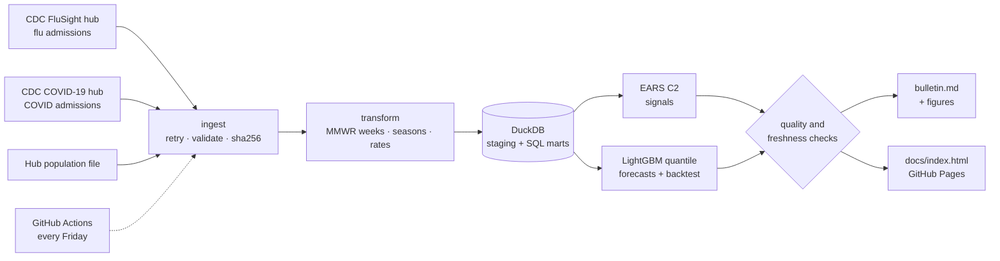

# US Respiratory Disease Surveillance


**Live dashboard: [madhubuddaraju.github.io/respiratory-surveillance](https://madhubuddaraju.github.io/respiratory-surveillance/)**
· **This week's bulletin: [`reports/bulletin.md`](reports/bulletin.md)**

An automated public-health surveillance system for **influenza and COVID-19 hospital admissions** in all 50
states, DC and Puerto Rico. Every week it pulls CDC's latest NHSN data, measures activity and trend in each
state, flags statistically unusual increases, forecasts the next four weeks with calibrated uncertainty, and
publishes a bulletin and an interactive dashboard, with no manual steps.


## What it shows (week ending October 10, 2026)

- **Flu season is starting early and fast.** National flu admissions have risen for **9 consecutive weeks** to
  **3,835**, which is **2.9x** the highest count at this point of the season in any of the previous four seasons.
  **24 states** show a statistically unusual increase, and 49 are trending up.
- **COVID-19 is easing.** Admissions fell 13% to 3,799 and activity is low in every state.
- **The forecast** for the week ending November 7 is about **6,500 flu admissions** (80% interval 4,800 - 8,400).
- **2024-25 was the most severe flu season** in this data (peak 16.3 admissions per 100k in February 2025).
- **Early warning:** in complete seasons the first flu signal in a state came a median of **7 weeks before its
  peak** (206 state-seasons; every signal preceded the peak).

The bulletin and charts in this repository are regenerated automatically each week, so the latest numbers are always
in [`reports/bulletin.md`](reports/bulletin.md).

| This season vs past seasons | Four-week forecast |
|---|---|
|  |  |


## Methods

**Data.** Weekly laboratory-confirmed hospital admissions reported by hospitals to the CDC National Healthcare
Safety Network (NHSN), as published in the CDC [FluSight](https://github.com/cdcepi/FluSight-forecast-hub) and
[COVID-19](https://github.com/CDCgov/covid19-forecast-hub) forecast hubs: COVID-19 from August 2020 and influenza
from February 2022. Rates use the hubs' population file. Every download is checksummed, and the manifest records
whether CDC published new data.

**Calendar.** Weeks are MMWR epidemiological weeks (Sunday-Saturday; week 1 contains January 4, so some years have
53 weeks). Respiratory seasons run from MMWR week 40 to week 39.

**Activity and trend.** Each state's 3-week average rate is compared with every state-week for that disease:
Low (< 40th percentile), Moderate (< 70th), High (< 90th), Very high. The trend is the 2-week change in the 3-week
average (±10%).

**Outbreak signals.** An EARS C2-style aberration detector, the family of methods CDC developed for syndromic
surveillance: this week is compared with the mean and spread of a 7-week baseline that ends 3 weeks earlier. The
2-week guard band keeps a building outbreak from raising its own baseline. A signal needs z ≥ 3 and at least 20
admissions.

**Forecasting.** Global LightGBM quantile regression (7 quantiles × 4 horizons) trained across all states and both
diseases, predicting the change in log rate from lagged values, local and national momentum and seasonality.
Quantiles are sorted so intervals never cross.

**Evaluation.** A rolling-origin backtest over the last 52 weeks, refitting every 4 weeks with only data that would
have been available at the time. Scoring uses the **weighted interval score (WIS)**, the rule CDC uses to rank
FluSight forecasts, relative to a baseline that carries the last value forward with empirical uncertainty.

| | 1 wk | 2 wk | 3 wk | 4 wk | 80% interval coverage |
|---|---|---|---|---|---|
| Influenza (relative WIS) | 0.59 | 0.56 | 0.60 | 0.61 | 69% |
| COVID-19 (relative WIS) | 0.61 | 0.58 | 0.59 | 0.61 | 79% |

The model cuts forecast error by roughly **40% versus the baseline** at every horizon. Flu intervals are somewhat
too narrow (69% coverage for a nominal 80%) because seasonal surges are sharper than the training history; widening
them with conformal calibration is the next improvement.


## Architecture



| SQL mart | Contents |
|---|---|
| `marts.weekly` | disease × location × week, rate, 3-week average, weekly change, 2-week growth |
| `marts.season_summary` | peak week and rate, cumulative burden, onset, severity rank |
| `marts.peak_timing` | each state's peak relative to the national peak |
| `marts.current_status` | latest activity level and trend for every location |
| `marts.alerts`, `marts.signal_lead_time` | aberration scores and how early signals came before peaks |
| `marts.forecasts`, `marts.backtest_summary` | quantile forecasts and their measured skill |

## Run it

```bash
git clone https://github.com/madhubuddaraju/respiratory-surveillance.git
cd respiratory-surveillance
python -m venv .venv && source .venv/bin/activate
make install
make all          # download, analyse, forecast, write reports/bulletin.md and docs/index.html (about 3 minutes)
open docs/index.html
make test
```

## Project structure

```
src/surveil/
  config.py      sources and surveillance parameters
  ingest.py      downloads with retries, validation and checksums
  transform.py   MMWR weeks, seasons, rates, data issues log
  load.py        DuckDB warehouse and SQL mart runner
  alerts.py      EARS C2 aberration detection
  forecast.py    quantile forecasting, WIS scoring, rolling backtest
  quality.py     integrity and freshness checks
  report.py      weekly bulletin and figures
  dashboard.py   self-contained HTML dashboard for GitHub Pages
  geo/           US state outlines as SVG paths (built once from us-atlas)
sql/             mart definitions
dashboard/       dashboard template
tests/           MMWR calendar, marts, alerts, WIS and forecasting tests on real-data fixtures
```

## Data notes

- Hospital reporting to NHSN was **voluntary from May 1 to October 31, 2024**, when the CMS requirement lapsed, so
  counts in that window are incomplete. These weeks are flagged (`reporting_mandatory = false`) and shaded in charts.
- Counts are confirmed admissions only, so true burden is higher. Recent weeks can be revised as hospitals backfill.
- This is an independent analysis of public data, not an official CDC product.

## License

MIT for the code. Data from CDC is in the public domain. State boundaries come from
[us-atlas](https://github.com/topojson/us-atlas) (ISC license, derived from US Census Bureau cartographic boundaries).
