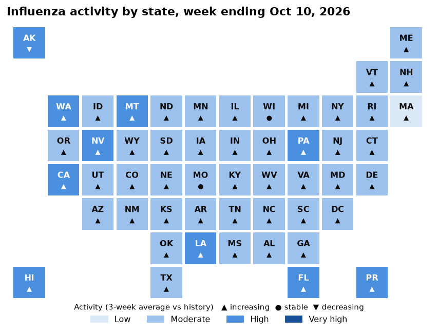
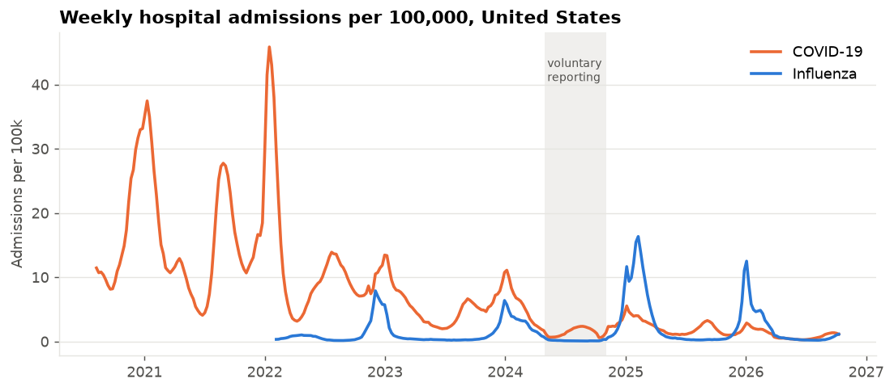
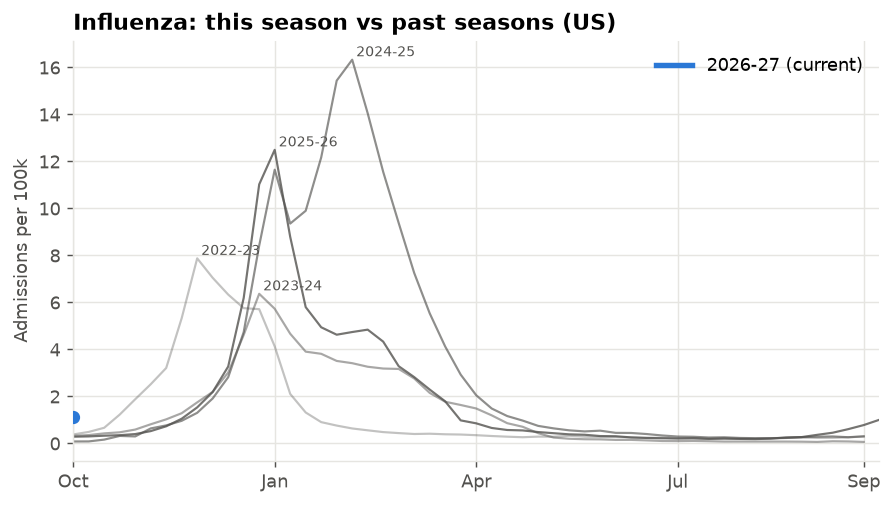
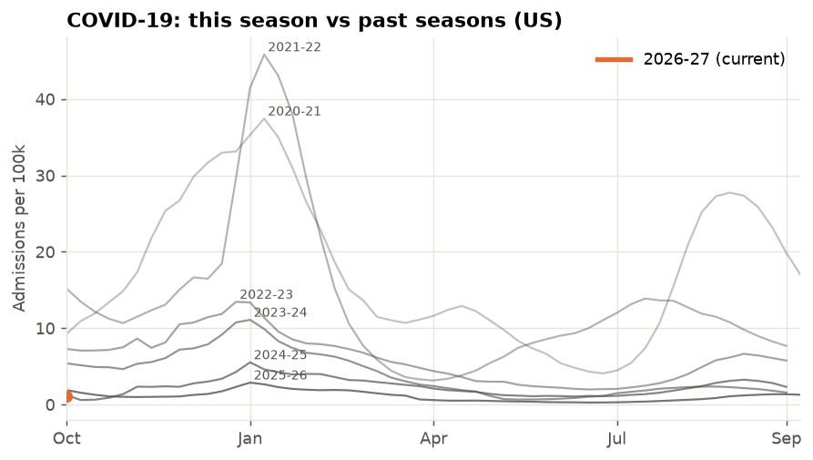
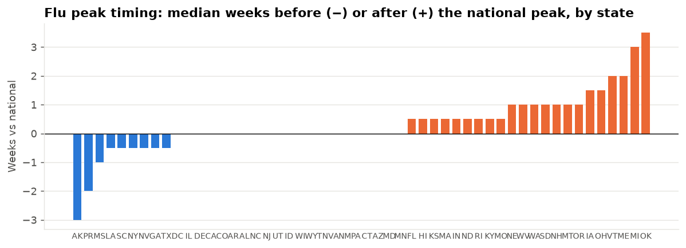
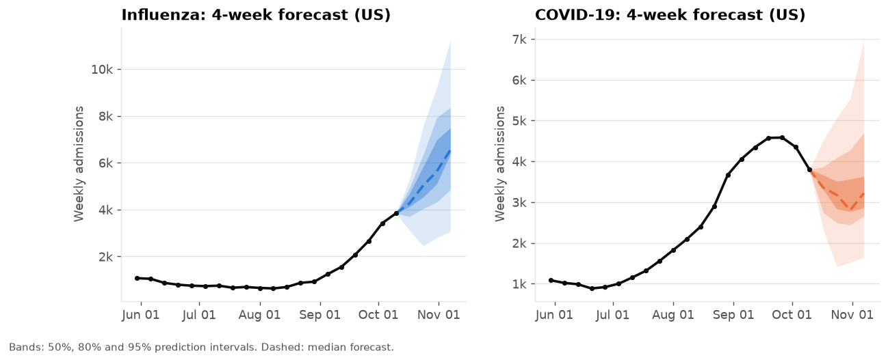
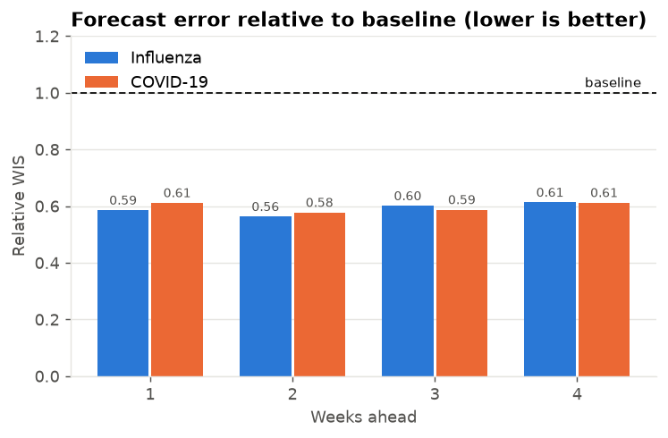

# US respiratory surveillance bulletin

_Week ending October 10, 2026. Generated 2026-10-16 by
`python -m surveil.report` from CDC NHSN hospital admissions. 7/7 data checks passed._

## This week
### Influenza
- **3,835 admissions** nationally in the week ending October 10
  (1.13 per 100k), +12% from the previous week;
  up for 9 consecutive weeks. That is **2.9x** the highest count at this point of any of the previous 4 seasons.
- Activity: 0 very high, 10 high, 41 moderate, 1 low (of 52 states/territories).
  Trend increasing in **49**.
- **24 jurisdictions** have a statistical signal this week (EARS C2, z ≥ 3)
  - AL, AZ, CA, CO, FL, GA, HI, IL, IN, KY, LA, MA, MS, MT, NC, NJ, NV, NY, OH, PA, PR, SC, TN, TX.
- 4-week forecast for the week ending November 07: **6,546**
  admissions (80% interval 4,841 - 8,354).
- Most severe complete season on record here: **2024-25** (peak 16.3 per 100k,
  week ending Feb 08, 2025).
### COVID-19
- **3,799 admissions** nationally in the week ending October 10
  (1.12 per 100k), -13% from the previous week;
  not in a sustained rise.
- Activity: 0 very high, 0 high, 0 moderate, 52 low (of 52 states/territories).
  Trend increasing in **21**.
- **3 jurisdictions** have a statistical signal this week (EARS C2, z ≥ 3)
  - CT, OR, WV.
- 4-week forecast for the week ending November 07: **3,218**
  admissions (80% interval 2,664 - 4,705).
- Most severe complete season on record here: **2020-21** (peak 37.4 per 100k,
  week ending Jan 09, 2021).

## Context

| Flu | COVID-19 |
|---|---|
|  |  |

- **Early warning works.** In complete seasons, the first flu signal in a state came a median of
  **7 weeks before that state's peak** (100% of signals
  came before the peak; n = 206 state-seasons).
- **Flu tends to peak first in** AK, PR, MS, LA and **last in**
  OK, MI, ME, VT (median weeks vs the national peak).

## Forecasts

Rolling-origin backtest over the last 52 weeks, all states (weighted interval score relative to a flat-line baseline;
below 1 is better):

| Disease | 1 wk | 2 wk | 3 wk | 4 wk | 80% interval coverage |
|---|---|---|---|---|---|
| Influenza | 0.59 | 0.56 | 0.60 | 0.61 | 69% |
| COVID-19 | 0.61 | 0.58 | 0.59 | 0.61 | 79% |

## Data notes
- Source: CDC National Healthcare Safety Network (NHSN) weekly confirmed admissions, as published to the CDC
  FluSight and COVID-19 forecast hubs. Rates use the hubs' population file.
- Hospital reporting was **voluntary from May 1 to Oct 31, 2024**, so counts in that window are incomplete
  (shaded in the national chart).
- Activity levels compare each state's 3-week average with the distribution of all state-weeks for that disease
  (Low < 40th percentile, Moderate < 70th, High < 90th, Very high ≥ 90th).

| Source | Fetched (UTC) |
|---|---|
| [flu](https://raw.githubusercontent.com/cdcepi/FluSight-forecast-hub/main/target-data/target-hospital-admissions.csv) | 2026-10-16 18:13 |
| [covid](https://raw.githubusercontent.com/CDCgov/covid19-forecast-hub/main/target-data/covid-hospital-admissions.csv) | 2026-10-16 18:13 |
| [locations](https://raw.githubusercontent.com/cdcepi/FluSight-forecast-hub/main/auxiliary-data/locations.csv) | 2026-10-16 18:13 |
